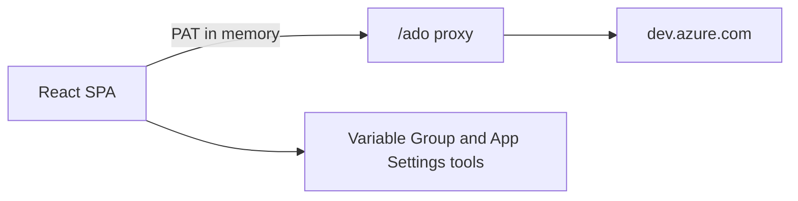
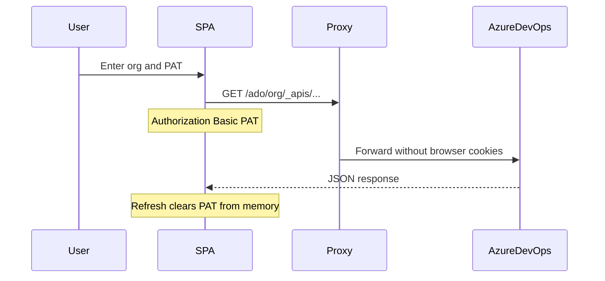

# ToolDock

**ToolDock is a browser toolkit for Azure DevOps engineers who want to manage variable groups and App Service settings without repetitive copy-paste.**


Frontend-only: no backend, no database. Paste a Personal Access Token (PAT) once per session; it stays in memory until you refresh.



## Who it's for

Azure DevOps engineers who maintain variable groups and App Service Deploy settings. ToolDock runs entirely in the browser: you connect with an org + PAT, pick a project, and use the tools. Two local tools work without a connection for pasted App Settings text.

## Features

| Feature | What it does |
| --- | --- |
| **Generate App Service Settings** | Turn a variable group into the `-KEY "$(KEY)"` string for the App Service Deploy task. |
| **Compare vs App Settings** | Diff a variable group against pasted App Settings (matched / missing / extra / duplicates). |
| **CSV Import** | Import `Key,Value` CSV into a variable group, with preview and confirmation before writing. |
| **Export Variable Group** | Export a variable group as CSV, JSON, or TXT. |
| **Duplicate Finder** | Find duplicate keys in pasted App Settings (no connection required). |
| **Sort App Settings** | Sort pasted App Settings alphabetically (no connection required). |

## Quick start

```bash
cd ui
npm install
npm run dev
```

Open [http://localhost:5173](http://localhost:5173), enter your **organization** and **PAT**, select a project, and use the tools.

Minimum PAT scopes (Azure DevOps → User settings → Personal access tokens):

- **Variable Groups** → Read, create, & manage (needed for CSV Import writes)
- **Project and Team** → Read (list projects)

Do not grant Full access.

## How it works

Azure DevOps REST APIs do not send CORS headers, so the browser cannot call `https://dev.azure.com` directly. ToolDock calls a relative `/ado/*` path; a same-origin proxy forwards those requests to Azure DevOps.



| Layer | Role |
| --- | --- |
| React SPA (`ui/`) | UI, session store, tool registry |
| `/ado` proxy | Vite (dev) or Vercel / Netlify / nginx (prod) |
| Azure DevOps | Projects + Variable Groups APIs |

API versions used in code: Projects `7.1`, Variable Groups `7.2-preview.2`.

Contributor depth (adding tools, layout notes): see [ui/README.md](ui/README.md).

## Security model

- The PAT lives **only in runtime memory** (Zustand). No `localStorage`, `sessionStorage`, cookies, or IndexedDB. **Refreshing the page clears it.**
- Auth header: `Authorization: Basic base64(":" + PAT)`. The PAT is never logged.
- The Vite / nginx proxies strip browser cookies before forwarding so unrelated localhost cookies are not sent to Azure DevOps.
- Write tools (CSV Import) learn write permission reactively from API responses; a 403 disables further writes for the session.

## Scripts

Run from `ui/`:

| Script | Command |
| --- | --- |
| `npm run dev` | Dev server with `/ado` → `dev.azure.com` proxy |
| `npm run build` | Typecheck + production build → `dist/` |
| `npm run preview` | Preview the production build |
| `npm run typecheck` | `tsc --noEmit` |
| `npm run lint` | ESLint (`--max-warnings 0`) |
| `npm run format` | Prettier on `src/**/*.{ts,tsx,css}` |

## Deploy

Build static assets, then serve `dist/` **and** rewrite `/ado/*` to Azure DevOps (proxy rules must come before the SPA fallback).

```bash
cd ui
npm run build
```

Ready-made configs in `ui/`:

| Platform | Config |
| --- | --- |
| Vercel | [ui/vercel.json](ui/vercel.json) — `/ado/:path*` rewrite + SPA fallback |
| Netlify | [ui/netlify.toml](ui/netlify.toml) — build `npm run build`, publish `dist`, `/ado/*` proxy |
| nginx | [ui/nginx.conf.example](ui/nginx.conf.example) — `proxy_pass` + cookie strip + `try_files` |

Point the host root directory at `ui/` (or copy the config next to your deploy root). No app env vars are required; org and PAT are entered in the UI.

## Tech stack

| Layer | Choice |
| --- | --- |
| UI | React 18, TypeScript 5 (strict), Vite 6 |
| Routing / data | React Router 6, TanStack Query 5 |
| State | Zustand 5 (in-memory session only) |
| Styling | Tailwind CSS 3, shadcn/ui (new-york), Lucide, Sonner |

## Project structure

```
ToolDock/
├── README.md                 # this showcase
└── ui/                       # entire application
    ├── README.md             # contributor guide
    ├── package.json
    ├── vite.config.ts        # /ado dev proxy
    ├── vercel.json
    ├── netlify.toml
    ├── nginx.conf.example
    ├── public/favicon.svg
    └── src/
        ├── features/
        │   ├── connection/   # connect screen
        │   └── tools/        # tool registry + tools
        ├── lib/api/          # ADO client helpers
        ├── store/            # sessionStore (PAT in memory)
        └── components/       # layout + UI primitives
```

## Extending

Sidebar and routes are generated from `ui/src/features/tools/registry.ts`:

1. Add `ui/src/features/tools/<your-tool>/YourTool.tsx`
2. Add one `ToolDefinition` entry to `TOOLS` in `registry.ts`

No separate router or sidebar edits. Details: [ui/README.md](ui/README.md).

## FAQ

**Why a proxy?** Azure DevOps does not send CORS headers. The browser must use a same-origin `/ado` rewrite.

**Is my PAT stored on disk?** No. It is held only in the Zustand session store. A refresh forces reconnection.

**Do all tools need auth?** No. Duplicate Finder and Sort App Settings work on pasted text without a connection. Variable Group tools require connect.

**Is there a backend?** No. ToolDock is a static SPA; Azure DevOps is the only remote API.

**Which API versions?** Projects use `7.1` (plain `7.2` is rejected without preview). Variable Groups use `7.2-preview.2`. See `ui/src/lib/constants.ts`.

## Contributing

Issues and merge requests are welcome on the project remote. There is no separate `CONTRIBUTING.md` yet — keep changes focused, match existing TypeScript/React patterns, and run `npm run typecheck` and `npm run lint` from `ui/` before opening an MR.

## License

License TBD — no `LICENSE` file is present in this repository yet.