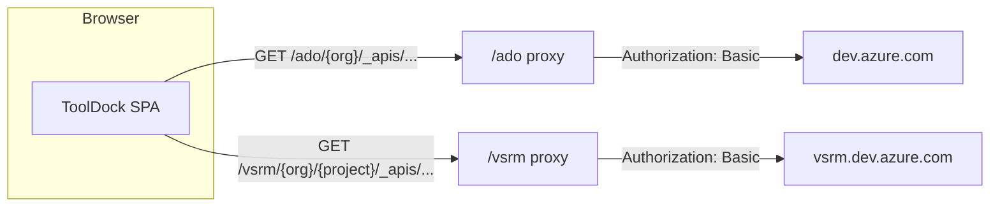

<p align="center">
  
</p>

# ToolDock

**ToolDock is a browser-only toolkit for Azure DevOps engineers who manage variable groups, App Service settings, and release pipeline variables - eleven focused tools instead of the portal plus a spreadsheet plus copy-paste.**


No backend. No database. No telemetry. Enter your organization and a Personal Access Token, pick a project, and work. Two tools require no account at all.



## Features

| Tool                              | What it does                                                                                                                            | Needs connection |
| --------------------------------- | --------------------------------------------------------------------------------------------------------------------------------------- | ---------------- |
| **Generate App Service Settings** | Builds the `-KEY "$(KEY)"` argument string from a variable group's variable names, one line or multiline                                | Yes              |
| **Compare vs App Settings**       | Diffs a variable group against pasted App Settings - matched / missing / extra / duplicate buckets, searchable, with a text report      | Yes              |
| **Variable Group Diff**           | Compares two variable groups key by key - changed, missing, and secret values highlighted; exports to XLSX with color-coded rows        | Yes              |
| **Multi-Group Compare**           | Compares 2–8 groups side by side in a pivot table - conflicts and missing keys surface across all environments at once; exports to XLSX | Yes              |
| **CSV Import**                    | Imports `Key,Value` rows into a variable group; shows a full per-key overwrite/new/same plan and requires confirmation before writing   | Yes              |
| **Export Variable Group**         | Exports one group as CSV, JSON, TXT, or XLSX; JSON matches the Azure DevOps variables shape                                             | Yes              |
| **Export All Variable Groups**    | Exports selected groups into one multi-sheet XLSX workbook, one sheet per group                                                         | Yes              |
| **Export Release Variables**      | Exports a release pipeline's inline variables - definition-level or a single stage - as CSV, JSON, TXT, or XLSX                         | Yes              |
| **Release Pipeline Mapping**      | Shows which release pipelines and stages consume each variable group; exports the full cross-reference to XLSX                          | Yes              |
| **Duplicate Finder**              | Finds duplicate keys in pasted App Settings, with line numbers and source highlighted                                                   | No               |
| **Sort App Settings**             | Sorts pasted App Settings alphabetically, preserving formatting                                                                         | No               |

CSV Import is the only tool that writes to Azure DevOps. Everything else reads.

All XLSX exports use a consistent style: navy header rows, color-coded data rows per status, and `[secret]` / `[empty]` placeholders in gray italic for values that cannot be shown.

## Quick start

```bash
cd ui
npm install
npm run dev
```

Open [http://localhost:5173](http://localhost:5173). Click any Azure DevOps tool to open the inline connect form, enter your **organization** and **PAT**, and select a project.

PAT scopes required (Azure DevOps → User settings → Personal access tokens):

| Scope                                    | Why                                                | Required |
| ---------------------------------------- | -------------------------------------------------- | -------- |
| Variable Groups → Read, create, & manage | Read variable groups; write changes via CSV Import | Yes      |
| Project and Team → Read                  | List projects in your organization                 | Yes      |
| Release → Read                           | Read release pipeline definitions                  | Optional |

Grant the Release scope only if you use the two Release Pipelines tools. A read-only PAT covers nine of the eleven tools.

## How it works

Azure DevOps sends no CORS headers, so the browser cannot call it directly. ToolDock requests same-origin relative paths that a proxy forwards to the correct upstream. There are two upstreams because release definitions live on a separate subdomain:

| Path      | Upstream                     | Used by                      |
| --------- | ---------------------------- | ---------------------------- |
| `/ado/*`  | `https://dev.azure.com`      | Projects, variable groups    |
| `/vsrm/*` | `https://vsrm.dev.azure.com` | Release pipeline definitions |

Every request carries `Authorization: Basic base64(":" + PAT)`.

Connection is gated at the route level. Clicking a gated tool with no active session renders the connect form inline in the same layout - the URL does not change, the sidebar stays visible. Once the PAT is validated against the projects list, the session activates and the tool renders automatically. Each connected tool additionally requires a selected project, enforced by a separate `RequireProject` guard.

## Security model

**By default the PAT lives only in memory.** The Zustand session store has no `persist` middleware - no `localStorage`, no `sessionStorage`, no cookies. Refreshing the page clears the session.

**Staying signed in is opt-in and encrypted.** The lock button in the header encrypts the PAT with AES-GCM-256 under a **non-extractable** `CryptoKey` and stores the ciphertext in IndexedDB for a rolling 30-minute window. The plaintext never touches disk. On next load the app decrypts before React mounts and renders as connected.

Key limitations of the vault:

- The 30-minute window is sliding - every successful restore resets it, so refreshing keeps the PAT on disk indefinitely.
- The vault defends against disk inspection, not against same-origin script. An XSS on your deployment is full PAT exposure.
- The organization name is stored in cleartext. The selected project is never persisted.
- On a shared machine, opting in means the next person to open the browser is connected as you.

Proxy notes:

- `Authorization: Basic` is encoding, not encryption. Verify that your deployment's access logs and WAF rules do not capture request headers - [nginx.conf.example](ui/nginx.conf.example) calls this out inline.
- The proxy paths (`/ado/*`, `/vsrm/*`) are protected by [Vercel Edge Middleware](ui/middleware.ts): only `GET` and `PUT` requests are forwarded, and requests whose `Origin` or `Referer` header does not match the app's domain are rejected with `403`. Set the `ALLOWED_ORIGIN` environment variable in your Vercel dashboard to your live domain (e.g. `https://tooldock.notbatman.me`) to activate the origin check - without it the check is skipped (safe for local dev). `VERCEL_URL` (injected automatically by Vercel) additionally covers the `.vercel.app` deployment URL so both domains work without extra config.
- The proxy still forwards any valid PAT supplied by the caller. HTTPS-only deployment and keeping the domain off shared infrastructure remain important.

## Scripts

Run from `ui/`:

| Script              | What it does                                           |
| ------------------- | ------------------------------------------------------ |
| `npm run dev`       | Dev server (port 5173) with `/ado` and `/vsrm` proxies |
| `npm run build`     | `tsc -b` then production build → `dist/`               |
| `npm run preview`   | Serve the production build locally                     |
| `npm run typecheck` | `tsc --noEmit`                                         |
| `npm run lint`      | ESLint with `--max-warnings 0`                         |
| `npm run format`    | Prettier on `src/**/*.{ts,tsx,css}`                    |

## Deploy

Build the static assets then serve `dist/` with proxy rules ahead of the SPA fallback. If the rewrites come after the fallback, requests resolve to `index.html` and the app reports that Azure DevOps did not return JSON.

```bash
cd ui && npm run build
```

| Platform | Config                                         |
| -------- | ---------------------------------------------- |
| Vercel   | [ui/vercel.json](ui/vercel.json)               |
| Netlify  | [ui/netlify.toml](ui/netlify.toml)             |
| nginx    | [ui/nginx.conf.example](ui/nginx.conf.example) |

Point the host's root directory at `ui/`. One environment variable to set on your host:

| Variable         | Value                     | Purpose                                              |
| ---------------- | ------------------------- | ---------------------------------------------------- |
| `ALLOWED_ORIGIN` | `https://your-domain.com` | Activates the proxy origin check (Vercel middleware) |

Organization and PAT are entered in the UI at runtime - no other env vars needed.

## Tech stack

| Layer            | Choice                                                                                           |
| ---------------- | ------------------------------------------------------------------------------------------------ |
| UI               | React 18, TypeScript 5 (strict), Vite 6                                                          |
| Routing and data | React Router 6, TanStack Query 5                                                                 |
| State            | Zustand 5 (in-memory); optional AES-GCM vault in IndexedDB                                       |
| Styling          | Tailwind CSS 3, shadcn/ui (Radix primitives), Lucide icons, Sonner                               |
| Spreadsheets     | ExcelJS (browser bundle via Vite alias) - full cell styling: fills, fonts, borders, merged cells |

## Project structure

```text
ToolDock/
├── README.md                  ← this file
└── ui/
    ├── README.md              ← contributor guide
    ├── vite.config.ts         ← /ado + /vsrm dev proxies
    ├── vercel.json
    ├── netlify.toml
    ├── nginx.conf.example
    └── src/
        ├── router.tsx         ← routes generated from the tool registry
        ├── features/
        │   ├── home/          ← landing page, tool grid
        │   ├── connection/    ← inline connect form
        │   └── tools/         ← registry.ts + one directory per tool
        ├── lib/
        │   ├── api/           ← client, auth header, errors, per-resource modules
        │   ├── hooks/         ← TanStack Query hooks
        │   └── utils/         ← patVault, csv, xlsx, groupDiff, groupCompare, appSettings, theme
        ├── store/             ← sessionStore (PAT, org, project)
        ├── types/             ← ado.ts, tools.ts
        └── components/        ← layout, common components, shadcn/ui primitives
```

## Extending

The sidebar, home page, and routes are generated from [`ui/src/features/tools/registry.ts`](ui/src/features/tools/registry.ts). Adding a tool is two steps:

1. Create `ui/src/features/tools/<your-tool>/YourTool.tsx`.
2. Append one `ToolDefinition` to `TOOLS` - `id`, `title`, `description`, `icon`, `group`, `path`, `component`, `requiresConnection`.

No router or sidebar edits needed. See [ui/README.md](ui/README.md) for the full contributor workflow.

## FAQ

**Why does it need a proxy?** Azure DevOps sends no CORS headers, so a browser cannot call `dev.azure.com` directly. All requests go to a same-origin path that a rewrite forwards.

**Is my PAT stored on disk?** Not unless you click the lock button. With the lock enabled it is stored AES-GCM-256 encrypted in IndexedDB for a rolling 30 minutes; the plaintext never hits disk. Without it, a refresh wipes the session.

**Does refreshing keep me connected?** Only with the lock enabled and within the 30-minute window. The selected project is never restored - you re-pick it each session.

**Do all tools need a connection?** No. Duplicate Finder and Sort App Settings work on pasted text with no account. The other nine need an organization, a PAT, and a selected project.

**Why do the Release Pipelines tools fail when the rest work?** They require the optional Release (Read) PAT scope and the `/vsrm` proxy rule. If your deployment predates that rule, add it.

## Contributing

Issues and merge requests welcome at [github.com/nishantxrana/tooldock](https://github.com/nishantxrana/tooldock). Run `npm run typecheck` and `npm run lint` from `ui/` before opening one. When a change touches the tool registry, API versions in `constants.ts`, or PAT storage, update both this file and [ui/README.md](ui/README.md) in the same merge request - those three facts drift fastest.

## License

License TBD - this repository has no `LICENSE` file, so usage rights are granted by default.
