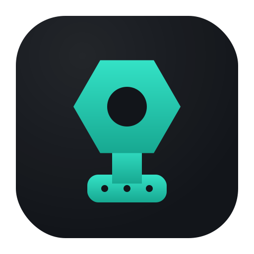
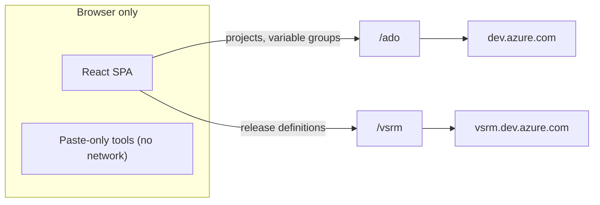
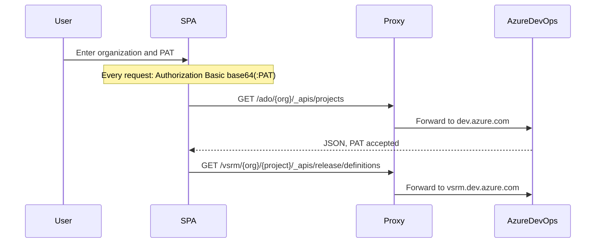

<p align="center">
  
</p>

# ToolDock

**ToolDock is a browser-only toolkit for Azure DevOps engineers who manage variable groups, App Service settings, and release pipeline variables — nine focused tools instead of the portal plus a spreadsheet plus copy-paste.**


No backend, no database, no telemetry. Connect with an organization and a Personal Access Token, pick a project, and work. Two tools need no account at all.



Every request on both paths carries the same `Authorization: Basic base64(":" + PAT)` header.

## Contents

- [Who it's for](#who-its-for)
- [Features](#features)
- [Quick start](#quick-start)
- [How it works](#how-it-works)
- [Security model](#security-model)
- [Scripts](#scripts)
- [Deploy](#deploy)
- [Tech stack](#tech-stack)
- [Project structure](#project-structure)
- [Extending](#extending)
- [FAQ](#faq)
- [Contributing](#contributing)
- [License](#license)

## Who it's for

Azure DevOps engineers who keep variable groups in sync with App Service Deploy settings, migrate inline release pipeline variables into variable groups, or need to know which pipelines actually consume a given variable group before changing it.

ToolDock runs entirely in your browser. Seven tools need a connected session and a selected project; Duplicate Finder and Sort App Settings work on pasted text with no account, so they are usable in zero clicks.

## Features

| Tool | What it does | Needs connection |
| --- | --- | --- |
| **Generate App Service Settings** | Builds the `-KEY "$(KEY)"` argument string from a variable group's variable names (values are ignored), as one line or multiline. | Yes |
| **Compare vs App Settings** | Diffs a variable group against pasted App Settings into matched / missing / extra / duplicate buckets, with search and a text report. | Yes |
| **CSV Import** | Imports `Key,Value` rows into a variable group. Shows a per-key overwrite/new/same plan and requires confirmation before writing. | Yes |
| **Export Variable Group** | Exports one group as CSV, JSON, TXT, or XLSX. JSON matches the Azure DevOps variables shape. | Yes |
| **Export All Variable Groups** | Exports the selected groups of a project into a single multi-sheet XLSX workbook, one sheet per group. | Yes |
| **Export Release Variables** | Exports a release pipeline's inline variables — definition-level or a single stage — as CSV, JSON, TXT, or XLSX, shaped for migration into a variable group. | Yes |
| **Release Pipeline Mapping** | Reverse index: for each variable group, which release pipelines and stages consume it. Exports every group and pipeline to XLSX. | Yes |
| **Duplicate Finder** | Finds duplicate keys in pasted App Settings, with line numbers and the source highlighted. | No |
| **Sort App Settings** | Sorts pasted App Settings alphabetically, preserving formatting. | No |

CSV Import is the only tool that writes to Azure DevOps. Everything else reads.

## Quick start

```bash
cd ui
npm install
npm run dev
```

Open [http://localhost:5173](http://localhost:5173), enter your **organization** and **PAT**, and select a project.

PAT scopes (Azure DevOps → User settings → Personal access tokens):

| Scope | Why | Required |
| --- | --- | --- |
| Variable Groups → Read, create, & manage | Read variable groups; write changes (CSV Import) | Yes |
| Project and Team → Read | List the projects in your organization | Yes |
| Release → Read | Read release pipeline definitions (the two Release Pipelines tools) | Optional |

Do not grant Full access. If you never use CSV Import, a read-only PAT covers eight of the nine tools — see [Security model](#security-model).

## How it works

Azure DevOps sends no CORS headers, so the browser cannot call it directly. ToolDock only ever requests same-origin relative paths, and a proxy forwards them. There are **two** upstreams, because release definitions live on a separate subdomain:

| Path | Upstream | Used by |
| --- | --- | --- |
| `/ado/*` | `https://dev.azure.com` | Projects, variable groups |
| `/vsrm/*` | `https://vsrm.dev.azure.com` | Release pipeline definitions |



Access to a tool is gated twice. The router wraps every registry entry with `requiresConnection: true` in [RequireConnection](ui/src/components/common/RequireConnection.tsx). When there is no session, an in-app click renders the connect form inline on the same URL, while a refresh or typed URL redirects to the home page so every tool stays visible. Each connected tool then wraps its own body in [RequireProject](ui/src/components/common/RequireProject.tsx), so project selection is enforced separately from the session.

API versions in use, from [ui/src/lib/constants.ts](ui/src/lib/constants.ts):

| Resource | Version |
| --- | --- |
| Projects | `7.1` |
| Variable groups | `7.2-preview.2` |
| Release definitions | `7.1` |

Plain `7.2` is rejected for projects without a preview flag, so the released `7.1` is used. Contributor depth — layout conventions, adding a tool — lives in [ui/README.md](ui/README.md).

## Security model

**By default the PAT never leaves memory.** [sessionStore.ts](ui/src/store/sessionStore.ts) is plain Zustand with no `persist` middleware: no `localStorage`, no `sessionStorage`, no cookies. Refreshing the page clears the session and forces reconnection.

**Staying signed in is opt-in and encrypted.** The lock button in the header hands the PAT to [patVault.ts](ui/src/lib/utils/patVault.ts), which encrypts it with AES-GCM-256 under a **non-extractable** `CryptoKey` and stores the ciphertext plus that key in IndexedDB (`tooldock-vault`). The plaintext PAT never touches disk. On the next load the app decrypts it before React mounts, so you render as already connected.

What the vault does and does not protect against:

- **30-minute window, sliding.** Every successful restore resets the clock, so periodic refreshes keep the PAT on disk indefinitely. Expiry deletes the disk copy but does not end the open session.
- **It defends against disk and browser-profile inspection, not against same-origin script.** The key cannot be exported, but any code running on ToolDock's origin can ask the browser to decrypt with it. Treat an XSS on your deployment as full PAT exposure for the lifetime of the vault entry.
- **The organization name is stored in cleartext** next to the ciphertext. The selected project is never persisted.
- **On a shared machine, opting in means the next person to open the browser is connected as you.** There is no PIN or re-entry prompt, and the in-memory session has no idle timeout.
- Disconnect wipes the vault, and the lock can be released manually at any time.

Transport and proxy notes:

- `Authorization: Basic base64(":" + PAT)` is encoding, not encryption. The header traverses whatever proxies your deployment uses. Self-hosters should confirm access logs, APM, and WAF rules do not capture request headers — [nginx.conf.example](ui/nginx.conf.example) calls this out inline.
- The proxy is **unauthenticated and unrestricted**: `/ado/*` forwards anything to Azure DevOps. A publicly reachable deployment is an open relay that anyone can use with their own PAT. Keep it private or put access control in front of it.
- Browser cookies are stripped in the Vite dev proxy and in the nginx example, because cookies shared across a host cause upstream `400 Bad Request`. Vercel and Netlify rewrites do not strip them, so avoid deploying on a domain shared with cookie-setting apps.

Permissions and data:

- **Least privilege works.** Only CSV Import needs the manage scope. Write permission cannot be introspected from the browser, so it is learned reactively: a rejected write flips `variableGroupsWritable` to `false`, disables the import button with an explanation, and leaves preview working for the rest of the session.
- **Writes replace the whole variables map.** The update endpoint requires a full body, so the client re-reads the authoritative group, applies the diff on top, and puts it back. The safety net is the preview plus confirmation dialog, not the API.
- **Secrets cannot be read back.** Azure DevOps returns secret variables with empty values; the export tools warn when a group contains them, and CSV Import always treats a secret as an overwrite.
- Non-secret variable **values** do land in your Downloads folder in plaintext when you export. Treat those files as configuration secrets.

## Scripts

Run from `ui/`:

| Script | What it does |
| --- | --- |
| `npm run dev` | Dev server (default port 5173) with the `/ado` and `/vsrm` proxies |
| `npm run build` | `tsc -b` then production build → `dist/` |
| `npm run preview` | Serve the production build locally |
| `npm run typecheck` | `tsc --noEmit` |
| `npm run lint` | ESLint with `--max-warnings 0` |
| `npm run format` | Prettier on `src/**/*.{ts,tsx,css}` |

## Deploy

Build the static assets, then serve `dist/` **and** rewrite both proxy paths. Proxy rules must come before the SPA fallback, or requests resolve to `index.html` and the app reports that Azure DevOps did not return JSON.

```bash
cd ui
npm run build
```

Ready-made configs, all covering `/ado` and `/vsrm`:

| Platform | Config |
| --- | --- |
| Vercel | [ui/vercel.json](ui/vercel.json) — both rewrites, plus a fallback that excludes them |
| Netlify | [ui/netlify.toml](ui/netlify.toml) — `force = true` proxies ahead of the SPA fallback |
| nginx | [ui/nginx.conf.example](ui/nginx.conf.example) — `proxy_pass` per upstream, cookie stripping, `try_files` |

Point the host's root directory at `ui/`. There are no application environment variables; organization and PAT are entered in the UI.

## Tech stack

| Layer | Choice |
| --- | --- |
| UI | React 18, TypeScript 5 (strict), Vite 6 |
| Routing and data | React Router 6, TanStack Query 5 (memory cache, `retry: 1`) |
| State | Zustand 5 for the session; optional AES-GCM vault in IndexedDB |
| Styling | Tailwind CSS 3, shadcn/ui (new-york), Radix primitives, Lucide, Sonner |
| Spreadsheets | SheetJS `xlsx` 0.20.3, installed from `cdn.sheetjs.com` rather than the npm registry |

## Project structure

```text
ToolDock/
├── README.md                  # this file
├── docs/                      # design specs
└── ui/                        # the entire application
    ├── README.md              # contributor guide
    ├── vite.config.ts         # /ado + /vsrm dev proxies
    ├── vercel.json, netlify.toml, nginx.conf.example
    ├── public/                # favicons and app icons
    └── src/
        ├── router.tsx         # routes generated from the tool registry
        ├── features/
        │   ├── connection/    # connect form and page
        │   ├── home/          # all tools, split by connection requirement
        │   └── tools/         # registry.ts + one directory per tool
        ├── lib/
        │   ├── api/           # client, auth header, errors, per-resource modules
        │   ├── hooks/         # TanStack Query hooks
        │   └── utils/         # patVault, csv, xlsx, diff, appSettings, theme
        ├── store/             # sessionStore (PAT, org, project)
        ├── types/             # ado.ts, tools.ts (ToolDefinition)
        └── components/        # layout, shared common pieces, shadcn/ui
```

## Extending

The sidebar, the home page, and the routes are all generated from [ui/src/features/tools/registry.ts](ui/src/features/tools/registry.ts). Adding a tool is two steps:

1. Create `ui/src/features/tools/<your-tool>/YourTool.tsx`.
2. Append one `ToolDefinition` to `TOOLS` — `id`, `title`, `description`, `icon`, `group`, `path`, `component`, `requiresConnection`.

No router or sidebar edits. `group` must be one of the `ToolGroup` values in [ui/src/types/tools.ts](ui/src/types/tools.ts), and `requiresConnection: false` keeps a paste-only tool ungated. Details in [ui/README.md](ui/README.md).

## FAQ

**Why does it need a proxy?** Azure DevOps sends no CORS headers, so a browser cannot call `dev.azure.com` directly. Every request goes to a same-origin path that a rewrite forwards.

**Is my PAT stored on disk?** Not unless you click the lock button. Then it is stored AES-GCM-256 encrypted in IndexedDB for a rolling 30 minutes, and the plaintext never hits disk. Without opting in, a refresh wipes it.

**Does refreshing keep me connected?** Only with the lock enabled and within the window. Even then the selected project is not restored, so you re-pick it.

**Do all tools need a connection?** No. Duplicate Finder and Sort App Settings operate on pasted text. The other seven need an organization, a PAT, and a selected project.

**Is there a backend?** No. ToolDock is a static SPA; the only remote APIs are Azure DevOps.

**Why do the Release Pipelines tools fail when the rest work?** They need the optional Release (Read) PAT scope and the `/vsrm` proxy rule. If your deployment predates that rule, add it.

**Why does `npm install` fetch from cdn.sheetjs.com?** SheetJS is distributed from its own CDN, so `package.json` pins the 0.20.3 tarball URL. It needs network access to that host at install time.

## Contributing

Issues and merge requests are welcome at [gitlab.com/nishantxrana/tooldock](https://gitlab.com/nishantxrana/tooldock). There is no `CONTRIBUTING.md` yet — keep changes focused, follow the existing TypeScript and React patterns, and run `npm run typecheck` and `npm run lint` from `ui/` before opening one.

There are no screenshots in the repo yet; a clean UI capture or a short demo GIF would be a genuinely useful contribution.

When a change touches the tool registry, API versions in `constants.ts`, or how the PAT is stored, update both this README and [ui/README.md](ui/README.md) in the same merge request — those are the three facts that drift fastest.

## License

License TBD — this repository has no `LICENSE` file yet, so no usage rights are granted by default.
